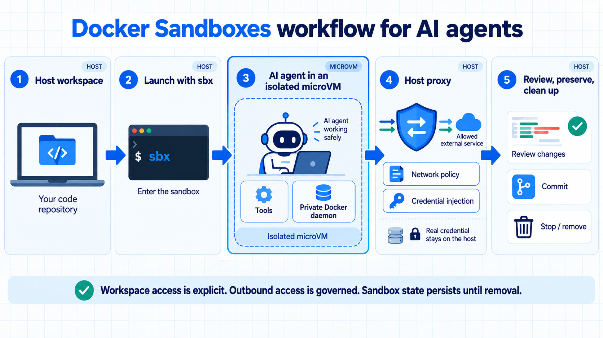

# Docker Sandboxes Tutorial Series

This repository contains the code examples and supporting assets for a tutorial
series about [Docker Sandboxes](https://docs.docker.com/ai/sandboxes/).
The series is designed for Docker users who are new to isolated environments
for AI agents.

We begin with the motivation for Docker Sandboxes and a first sandbox workflow.
From there, we explore workspace access, persistence, networking, credentials,
the private Docker daemon, coding agents, Docker Model Runner, reusable kits,
and the differences between local and cloud sandboxes.

## What the series covers

- When to use a Docker Sandbox instead of direct host execution or a container.
- How microVM isolation, workspaces, networking, and credentials fit together.
- How to run and review AI coding-agent workflows safely.
- How to connect sandboxed agents to Docker Model Runner.
- How to build repeatable environments with templates, environment files, and
  kits.
- How local and cloud sandboxes differ.

## Tutorials

Tutorial articles and their released code examples will be added here as the
series is published.

| Tutorial | Article | Code |
| --- | --- | --- |
| **What is Docker Sandboxes?** | Coming soon | — |
