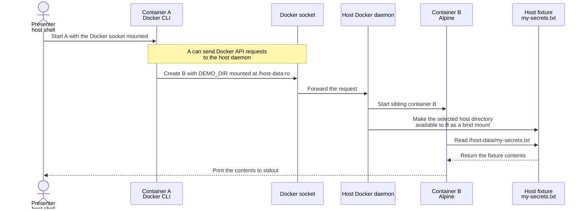
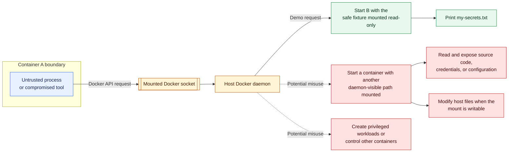

# Docker socket demonstration

This six-minute demonstration follows slides 16–18 as a two-step comparison. First, Container A starts without the host Docker socket and cannot read the workshop's dummy `my-secrets.txt` fixture. Second, A receives the socket and asks the host daemon to create Container B, which mounts the fixture directory read-only and prints the deliberately fake credentials.

The browser deck illustrates and explains this request chain. It never runs Docker commands or displays a fabricated terminal result.

## Demo at a glance

Container A never receives `my-secrets.txt` directly. Without the socket, its attempt to read `/host-data/my-secrets.txt` fails because that path is absent. With the socket, A can ask the host daemon to create a sibling container with the fixture directory mounted inside it. Container B reads the dummy file and prints it back to the presenter's terminal.



The important boundary is the socket connection between A and the daemon. The `:ro` option makes this one bind mount read-only; it does not limit which other Docker API requests A can make.

## Preparation in the host shell

Run from `workshops/01_ODSC_AI_WEST_2026/` in a terminal on the presenter machine. Use the local Docker daemon, not a remote context: bind-mount paths are resolved on the daemon host. On macOS this demonstration uses Docker Desktop, whose Linux VM and file-sharing settings mediate access to the Mac folder.

```bash
docker context show
docker version
export DEMO_DIR="$PWD/demo/01-docker-socket/fixture"
test -f "$DEMO_DIR/my-secrets.txt"
cat "$DEMO_DIR/my-secrets.txt"
docker pull docker:cli
docker pull alpine
```

Confirm the selected context is the intended local engine before proceeding. Pre-pull images and inspect the harmless fixture before the session. No personal files, secrets, full home directory, or root filesystem are needed. Do not change daemon or Desktop security settings to make the demonstration work; use the fallback if existing policy blocks socket access.

`DEMO_DIR` is an absolute host path prepared here. The host shell expands it before container A starts; A does not discover the host directory itself. The `:ro` below protects the fixture mount in B. It does not restrict the API authority granted by the Docker socket.

## Step 1 — no socket, no host file

Container A receives no host mount and no Docker socket. The path does not exist inside A:

```bash
docker run --rm docker:cli \
  cat /host-data/my-secrets.txt
```

Expected stderr and exit code:

```text
cat: can't open '/host-data/my-secrets.txt': No such file or directory
exit code 1
```

## Step 2 — socket access changes the result

```bash
docker run --rm \
  -v /var/run/docker.sock:/var/run/docker.sock \
  docker:cli \
  docker run --rm \
    -v "$DEMO_DIR:/host-data:ro" \
    alpine cat /host-data/my-secrets.txt
```

Expected result, to compare with the actual terminal run:

```text
# DEMO VALUES ONLY — NOT REAL CREDENTIALS
LLM_API_KEY=demo_llm_7H3K9P2M6R4X
VECTOR_DB_API_KEY=demo_vec_8N5Q1T7V3C9L
OBSERVABILITY_API_KEY=demo_obs_4W8D2J6S0F5A
```

Both containers use `--rm` and exit after printing the file. The fixture remains in the workshop folder. The downloaded images remain cached; this demo does not prune images or remove unrelated resources.

## What to explain

| Highlight step | Code lines | Observation / explanation |
| --- | --- | --- |
| 1 | 1, 3 | Host shell starts A from an image containing a Docker client |
| 2 | 2 | A receives a client connection to the host daemon |
| 3 | 4 | A's client asks that daemon to start B |
| 4 | 5 | The daemon supplies the deliberately chosen read-only bind mount to B |
| 5 | 6 | B reads the fixture and returns its contents |
| 6 | 1–6 | The file mount belongs to B; the socket connection belongs to A |

The two containers are siblings managed by the same daemon. This is not Docker-in-Docker and does not demonstrate a kernel exploit. Socket exposure is a deliberate configuration, not a feature of every container. Actual daemon privileges, authorization controls, and Desktop file sharing affect the result.

## Why the socket mount is risky

The harmless fixture demonstrates a broader capability. A process that can control the Docker daemon can ask it to start new containers, select daemon-visible host paths, and choose whether those paths are mounted read-only or writable. If an untrusted tool or agent runs in container A, the container boundary does not meaningfully restrict the requests it can send through an unrestricted Docker socket.



Read the solid path as the controlled demonstration and the dotted paths as examples of the authority that made the demonstration possible. On native Linux, the daemon host is usually the machine itself. With Docker Desktop, the daemon runs in a Linux VM and file-sharing policy mediates which Mac paths it can mount. Either way, socket access should be treated as a high-trust capability rather than an ordinary data-volume mount.

## Six-minute route and fallback

- **Minutes 0–2:** Show the dummy fixture, run Step 1, and confirm the path is absent inside A.
- **Minutes 2–5:** Add the socket mount, run Step 2, and inspect the dummy keys printed by B.
- **Minute 5–6:** Connect the contrast to the daemon request and the socket diagram.

If the engine, socket, image registry, or file sharing prevents a run, use the [recorded-result replay](fallback/socket-recorded-result.html). It shows the captured two-step result and is labeled as a recording. [verification.md](verification.md) records the tested versions and image digests.

Slide 16's diagram is an illustration of the mechanism. Do not present an expected result or replay as a successful new live execution.

Record the final presentation-machine versions and image digests during rehearsal; floating image tags can change. Preserve the full ten-minute Q&A at the end of the workshop.

## Sources

- [Docker daemon attack surface](https://docs.docker.com/engine/security/#docker-daemon-attack-surface)
- [Bind-mount considerations](https://docs.docker.com/engine/storage/bind-mounts/#considerations-and-constraints)
- [Docker Desktop permissions on Mac](https://docs.docker.com/desktop/setup/install/mac-permission-requirements/)
